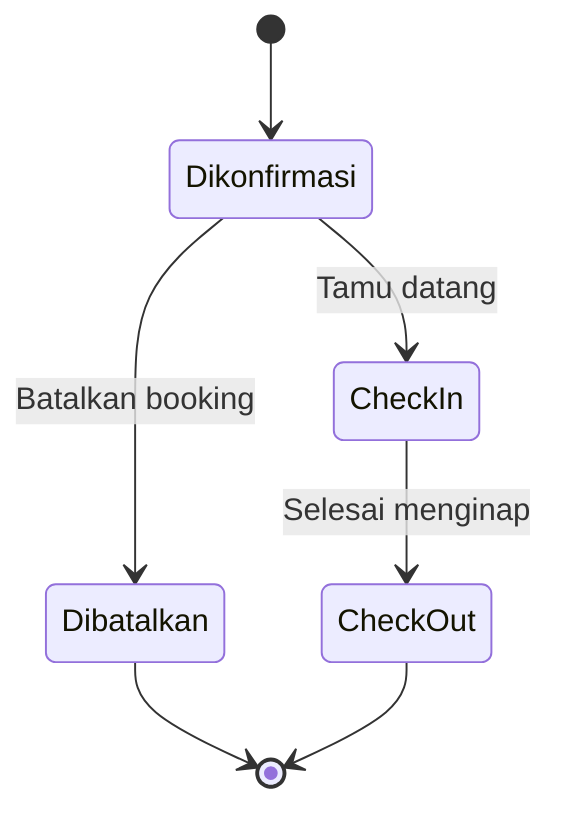
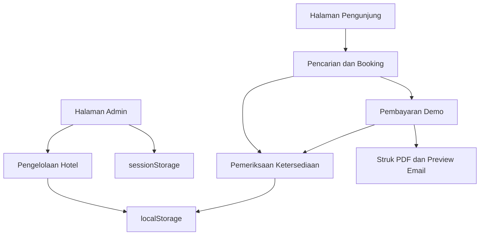

# SÉLA Stay — Boutique Hotel Booking & Management System 🏨


**SÉLA Stay** adalah aplikasi web booking dan pengelolaan hotel yang
dikembangkan oleh **KHALILURRAHMAN MAHDI** sebagai proyek portofolio
pengembangan web.

Mengangkat konsep **boutique hotel di Ubud, Bali**, aplikasi ini
menghadirkan alur pemesanan dari pencarian kamar berdasarkan tanggal,
pengisian data tamu, simulasi pembayaran, hingga penerbitan bukti
pembayaran PDF.

Di sisi admin, tersedia dashboard statistik, grafik booking,
pengelolaan reservasi, serta CRUD tipe dan nomor kamar. Seluruh
fitur berjalan **tanpa database**, menggunakan penyimpanan browser.

> **Demo portofolio:** hotel, reservasi, dan pembayaran bersifat
> simulasi. Aplikasi tidak menerima pembayaran atau mengirim email
> sungguhan.

---

## 🚀 Demo & Tautan

- 💻 **Website lokal:** http://localhost:3000
- 🔐 **Admin lokal:** http://localhost:3000/admin
- 🌐 **Live demo:** https://hotel-sela-stay.vercel.app/
- 📁 **Repository:** [https://github.com/khalilurrahmanmahdi12/hotel-sela-stay.](https://github.com/khalilurrahmanmahdi12/hotel-sela-stay.)
- 💼 **Portofolio:** [khalildev.web.id](https://khalildev.web.id/)
- 👨‍💻 **GitHub:** [khalilurrahmanmahdi12](https://github.com/khalilurrahmanmahdi12)

---

## ✨ Fitur Pengunjung

### 🔎 1. Pencarian Kamar Berdasarkan Tanggal

- Memilih tanggal **check-in** dan **check-out**.
- Mengatur jumlah tamu menggunakan tombol **− / +**.
- Memfilter tipe kamar berdasarkan kapasitas dan ketersediaan.
- Menghitung durasi menginap dan total harga secara otomatis.
- Memvalidasi tanggal check-in dan urutan tanggal menginap.
- Menampilkan kondisi ketika tidak ada kamar yang sesuai.

### 🛏️ 2. Detail Tipe Kamar

Informasi kamar ditampilkan melalui popup yang berisi:

- Deskripsi tipe kamar.
- Luas kamar dalam meter persegi.
- Jenis tempat tidur.
- Kapasitas tamu.
- Pemandangan.
- Daftar fasilitas.
- Aturan check-in dan check-out.

Popup dapat ditutup melalui tombol tutup, klik area luar, atau
tombol **Esc**.

### 📝 3. Booking Bertahap

Alur pemesanan dibagi menjadi empat tahap:

1. **Pilih Kamar**
2. **Data Pemesan**
3. **Pembayaran**
4. **Selesai**

Penanda tahap dan perpindahan fokus membantu pengunjung mengikuti
proses pemesanan, termasuk ketika menggunakan keyboard.

Data pemesan mencakup **nama lengkap, email, dan nomor HP**.

### 🔢 4. Pemilihan Nomor Kamar Otomatis

- Setiap kamar fisik memiliki nomor dan tipe kamar.
- Sistem memeriksa benturan tanggal menginap.
- Nomor dipilih saat pembayaran demo diselesaikan.
- Kamar berstatus **Perawatan** atau **Nonaktif** tidak dipilih.
- Booking yang dibatalkan tidak lagi memblokir ketersediaan.
- Check-out dan check-in pada tanggal yang sama diperbolehkan.

Penyimpanan booking menggunakan **Web Locks API** untuk
mengoordinasikan proses booking antar-tab yang menggunakan mekanisme
penguncian yang sama.

### 💳 5. Simulasi Pembayaran

| Metode | Tampilan |
|---|---|
| **QRIS** | QR berisi teks demo |
| **Virtual Account** | Nomor contoh `12345678` |
| **Tunai** | Simulasi penerimaan pembayaran di resepsionis |

Detail metode baru muncul setelah pengunjung menekan **Bayar**.
Pengunjung kemudian dapat menyelesaikan simulasi pembayaran.

**QR demo bukan QRIS pembayaran yang valid. Tidak diperlukan transfer,
data kartu, atau rekening asli.**

### 🧾 6. Struk PDF & Preview Email

Setelah pembayaran demo berhasil:

- Menampilkan kode booking.
- Menampilkan tipe dan nomor kamar.
- Menampilkan rincian pemesan serta tanggal menginap.
- Menyediakan unduhan bukti pembayaran **PDF**.
- Menampilkan **preview email** bukti pembayaran.

Preview email hanya ditampilkan di aplikasi dan **tidak dikirim
ke inbox**.

---

## 🛠️ Fitur Admin

### 📊 1. Dashboard Statistik & Grafik

Dashboard dipisahkan dari halaman Data Booking dan menampilkan:

- Total booking dengan pembayaran demo selesai.
- Akumulasi pendapatan simulasi.
- Total malam terpesan.
- Rata-rata nilai pembayaran per booking.
- Grafik jumlah booking per tipe kamar.
- Grafik pendapatan per tipe kamar.
- Grafik penggunaan metode pembayaran.

### 📋 2. Pengelolaan Booking

- Melihat daftar dan detail pemesan.
- Melihat tipe serta nomor kamar.
- Mencari berdasarkan nama, email, nomor HP, kode, atau nomor kamar.
- Memfilter berdasarkan tipe kamar.
- Memfilter berdasarkan status menginap.
- Memfilter rentang tanggal check-in.
- Mengubah status melalui popup detail.
- Menghapus booking yang **Dibatalkan** atau sudah **Check-out**,
  dengan konfirmasi.

Status pembayaran dan status menginap dikelola secara terpisah.



Pembatalan tidak memproses refund. Statistik pendapatan mencakup
pembayaran demo yang masih tersimpan, termasuk booking yang
dibatalkan. Menghapus booking akan mengubah statistik tersebut.

### 🏷️ 3. CRUD Tipe Kamar

Admin dapat menambah, melihat, mengubah, dan menghapus tipe kamar.

Informasi yang dikelola:

- Nama tipe kamar.
- Harga per malam.
- Kapasitas tamu.
- Luas kamar.
- Jenis tempat tidur.
- Pemandangan.
- Deskripsi.
- Fasilitas.
- Status tampil di website.

Tipe kamar yang masih memiliki nomor kamar atau riwayat booking
terkait tidak dapat langsung dihapus.

Perubahan harga tidak mengubah nilai pembayaran pada booking
yang sudah selesai.

### 🚪 4. CRUD Nomor Kamar

Nomor kamar fisik dikelola terpisah dari tipe kamar.

| Contoh nomor | Tipe kamar |
|---|---|
| 101, 102, 103 | Garden Deluxe |
| 201, 202 | Poolside Suite |
| 301, 302 | Family Retreat |

Status operasional yang tersedia:

- **Aktif**
- **Perawatan**
- **Nonaktif**

Nomor yang sudah memiliki riwayat booking bernomor kamar tidak dapat
dihapus. Perubahan identitas nomor dan tipe juga dibatasi untuk
menjaga keterkaitan riwayat.

### 🔐 5. Login & Logout Demo

- Form email dan password.
- Tombol menampilkan atau menyembunyikan password.
- Tombol pengisian akun contoh.
- Sesi demo menggunakan `sessionStorage`.
- Logout tanpa menghapus data kamar atau booking.

> Login diperiksa di browser dan kredensial demo tersedia dalam
> source code. Mekanisme ini bukan autentikasi atau otorisasi server.

---

## 🏗️ Arsitektur Aplikasi



### Penyimpanan Data

| Data | Penyimpanan |
|---|---|
| Tipe kamar dan fasilitas | `localStorage` |
| Nomor kamar dan status operasional | `localStorage` |
| Booking dengan pembayaran demo selesai | `localStorage` |
| Status menginap | `localStorage` |
| Riwayat nama tipe kamar | `localStorage` |
| Sesi login admin demo | `sessionStorage` |

Perubahan data browser dibaca melalui hook berbasis
`useSyncExternalStore`, event penyimpanan, dan event pembaruan aplikasi.

---

## 🎨 Desain & Pengalaman Pengguna

SÉLA Stay menggunakan gaya visual boutique hotel:

- **Hijau gelap** sebagai warna utama.
- **Krem** sebagai latar halaman.
- **Aksen emas hangat** untuk detail visual.
- Tipografi serif pada judul dan sans-serif pada isi.
- Dua kolom kartu kamar di ponsel dan tiga kolom di desktop.
- Popup detail dengan konten yang tetap dapat digulir.
- Form dengan label, validasi, dan pesan kesalahan.
- Penanda tahap serta pengelolaan fokus saat booking.
- Penghormatan terhadap preferensi reduced motion pada perpindahan
  langkah.

---

## 🧰 Teknologi yang Digunakan

| Teknologi | Penggunaan |
|---|---|
| **Next.js 16.4.3** | App Router, routing, layout, dan production build |
| **React** | Komponen dan interaksi antarmuka |
| **TypeScript** | Tipe data kamar, booking, dan pembayaran |
| **Tailwind CSS** | Styling dan tata letak responsif |
| **jsPDF** | Pembuatan struk PDF di browser |
| **qrcode.react** | Pembuatan QR demo |
| **Web Storage API** | Penyimpanan data dan sesi |
| **Web Locks API** | Koordinasi penyimpanan booking antar-tab |
| **ESLint** | Pemeriksaan kode |

---

## 🚀 Menjalankan Project

### 1. Persiapan

Gunakan **Node.js 24 LTS**, npm, dan Git.

### 2. Ambil Source Code

Clone repository menggunakan URL project ini, lalu masuk ke folder
`sela-stay`.

### 3. Install Dependensi

```bash
npm ci
```

### 4. Jalankan Development Server

```bash
npm run dev
```

Buka **http://localhost:3000**.

### 5. Periksa Kode

```bash
npx eslint .
```

### 6. Build Production

```bash
npm run build
```

### 7. Jalankan Hasil Build

```bash
npm run start
```

Jika development server masih memakai port 3000, hentikan terlebih
dahulu atau gunakan port lain.

---

## 🔑 Akun Admin Demo

Buka **http://localhost:3000/admin**.

| Field | Nilai |
|---|---|
| Email | `admin@sela.test` |
| Password | `sela123` |

Gunakan tombol **Isi akun demo** untuk mengisi form secara otomatis.

---

## 📂 Struktur Utama Project

| Lokasi | Fungsi |
|---|---|
| `src/app/page.tsx` | Beranda pengunjung |
| `src/app/layout.tsx` | Root layout dan metadata |
| `src/app/globals.css` | Styling global |
| `src/app/admin/layout.tsx` | Layout dan navigasi admin |
| `src/app/admin/page.tsx` | Dashboard ringkasan dan grafik |
| `src/app/admin/bookings/page.tsx` | Pengelolaan booking |
| `src/app/admin/rooms/page.tsx` | CRUD tipe kamar |
| `src/app/admin/room-units/page.tsx` | CRUD nomor kamar |
| `src/components/RoomSearch.tsx` | Pencarian, booking, dan pembayaran |
| `src/components/RoomDetails.tsx` | Popup detail tipe kamar |
| `src/components/BookingSteps.tsx` | Penanda tahap booking |
| `src/components/BookingStepFocus.tsx` | Perpindahan fokus dan scroll |
| `src/components/AdminBookingActions.tsx` | Detail dan status booking |
| `src/components/AdminDemoGate.tsx` | Login serta logout demo |
| `src/lib/useRooms.ts` | Data dan operasi tipe kamar |
| `src/lib/useRoomUnits.ts` | Data dan operasi nomor kamar |
| `src/lib/useAdminBookings.ts` | Pembacaan dan penghapusan booking |
| `src/lib/useBookingStatuses.ts` | Pembacaan status menginap |
| `src/lib/bookingAvailability.ts` | Ketersediaan dan alokasi nomor kamar |
| `src/lib/downloadReceipt.ts` | Pembuatan bukti pembayaran PDF |

---

## 🧪 Skenario Pengujian Manual

1. Cari kamar menggunakan tanggal mendatang dan jumlah tamu.
2. Buka detail tipe kamar.
3. Selesaikan booking dengan data contoh.
4. Pastikan nomor kamar tampil pada struk dan PDF.
5. Ulangi booking pada tanggal yang sama untuk memeriksa alokasi nomor.
6. Pastikan tipe tidak tersedia ketika seluruh nomor terpakai.
7. Batalkan booking di admin dan periksa kembali ketersediaannya.
8. Ubah nomor kamar menjadi Perawatan dan pastikan tidak dipilih
   untuk booking baru.
9. Tambahkan tipe kamar beserta nomor kamar baru.
10. Hapus booking yang dibatalkan atau selesai check-out.
11. Coba login, refresh halaman admin, dan logout.

---

## 📌 Status Project

- ✅ Pencarian kamar berdasarkan tanggal dan tamu
- ✅ Popup detail tipe kamar
- ✅ Booking bertahap
- ✅ Pemeriksaan benturan tanggal
- ✅ Alokasi nomor kamar otomatis
- ✅ Simulasi QRIS, Virtual Account, dan tunai
- ✅ Struk pembayaran PDF
- ✅ Preview email
- ✅ Dashboard statistik dan grafik
- ✅ Filter dan pengelolaan booking
- ✅ CRUD tipe kamar
- ✅ CRUD nomor kamar
- ✅ Login dan logout admin demo
- ✅ Pemeriksaan ESLint dan production build

---

## ⚠️ Batasan Demo

- **Tidak menggunakan database atau backend penyimpanan bersama.**
- Data hanya tersedia pada browser dan origin yang sama.
- Data dari `localhost` tidak otomatis berpindah ke domain Vercel.
- Pengunjung di perangkat lain memiliki data demo sendiri.
- Menghapus data situs akan menghapus data yang tersimpan.
- Pembayaran tidak terhubung ke payment gateway.
- QR demo tidak dapat digunakan untuk membayar.
- Email tidak benar-benar dikirim.
- Login admin tidak memberikan keamanan seperti autentikasi server.
- Gunakan localhost atau HTTPS pada browser yang mendukung Web Locks
  untuk menyelesaikan booking.
- Koordinasi antar-tab berlaku pada operasi yang menggunakan
  mekanisme penguncian yang sama, bukan transaksi database.
- Booking lama tanpa nomor kamar menyisihkan kapasitas secara
  konservatif.
- Gunakan data pemesan contoh saat mencoba aplikasi.

---

## 👨‍💻 Developer

**KHALILURRAHMAN MAHDI**  
*Web Developer*

- 🔗 **GitHub:** [github.com/khalilurrahmanmahdi12](https://github.com/khalilurrahmanmahdi12)
- 💼 **Portofolio:** [khalildev.web.id](https://khalildev.web.id/)

---

## ⭐ Dukungan

Jika project ini menarik atau membantu sebagai referensi belajar,
silakan berikan ⭐ pada repository.

**SÉLA Stay — Beri waktu untuk jeda.**
